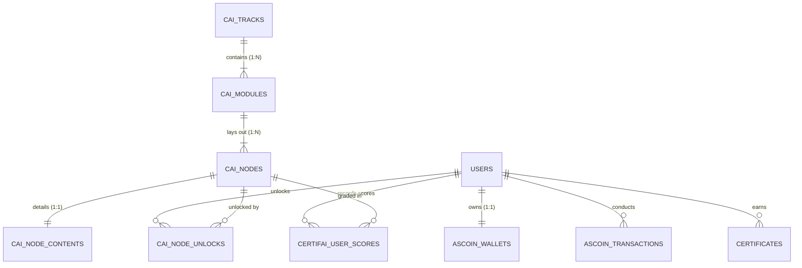

# ASBots CertifAI Mobile App — Database & Architecture Specification

> **Platform:** ASBots (CertifAI Module)  
> **Target Client:** Native Android Mobile App (Kotlin / Jetpack Compose) & Web  
> **Database:** MariaDB / MySQL (InnoDB Engine, `utf8mb4_unicode_ci`)  
> **Scope:** CertifAI Roadmap, User Authentication, ASCoins Virtual Economy & Certification  
> **Version:** 2.0 (Production Specification)

---

## 1. Entity-Relationship Diagram (ERD)



---

## 2. CertifAI Core Roadmap Tables

### 2.1 `cai_tracks` — Primary Learning Tracks
Defines the top-level tracks (e.g., *AI Engineer & Autonomous Agents*).

```sql
CREATE TABLE `cai_tracks` (
  `id` int(11) NOT NULL AUTO_INCREMENT,
  `slug` varchar(100) NOT NULL,
  `title` varchar(255) NOT NULL,
  `subtitle` varchar(255) DEFAULT NULL,
  `description` text DEFAULT NULL,
  `badge_icon` varchar(100) DEFAULT 'shield-check',
  `estimated_hours` int(11) DEFAULT 40,
  `is_published` tinyint(1) DEFAULT 1,
  `order_index` int(11) DEFAULT 0,
  `created_at` timestamp NOT NULL DEFAULT current_timestamp(),
  PRIMARY KEY (`id`),
  UNIQUE KEY `slug` (`slug`),
  KEY `idx_published_order` (`is_published`,`order_index`)
) ENGINE=InnoDB DEFAULT CHARSET=utf8mb4 COLLATE=utf8mb4_unicode_ci;
```

---

### 2.2 `cai_modules` — Curriculum Modules
Modules partition each track into milestones (e.g., *Python Foundations*, *Statistics & Mathematics*).

```sql
CREATE TABLE `cai_modules` (
  `id` int(11) NOT NULL AUTO_INCREMENT,
  `track_id` int(11) NOT NULL,
  `module_key` varchar(50) NOT NULL,
  `title` varchar(255) NOT NULL,
  `category` varchar(100) NOT NULL,
  `theme_color` varchar(50) DEFAULT 'blue',
  `icon` varchar(100) DEFAULT 'terminal',
  `order_index` int(11) NOT NULL DEFAULT 1,
  `reward_coins` int(11) DEFAULT 50,
  `is_published` tinyint(1) DEFAULT 1,
  `created_at` timestamp NOT NULL DEFAULT current_timestamp(),
  PRIMARY KEY (`id`),
  UNIQUE KEY `module_key` (`module_key`),
  KEY `idx_track_mod` (`track_id`,`is_published`,`order_index`),
  CONSTRAINT `fk_cai_mod_track` FOREIGN KEY (`track_id`) REFERENCES `cai_tracks` (`id`) ON DELETE CASCADE
) ENGINE=InnoDB DEFAULT CHARSET=utf8mb4 COLLATE=utf8mb4_unicode_ci;
```

---

### 2.3 `cai_nodes` — Roadmap Topic Nodes
Represents each interactive node in the curriculum. Designed for **6-node horizontal cluster layouts**.

```sql
CREATE TABLE `cai_nodes` (
  `id` int(11) NOT NULL AUTO_INCREMENT,
  `module_id` int(11) NOT NULL,
  `column_index` int(11) NOT NULL DEFAULT 1,
  `position` enum('top','bottom') NOT NULL DEFAULT 'top',
  `height_variant` enum('short','medium','tall') NOT NULL DEFAULT 'medium',
  `order_index` int(11) NOT NULL DEFAULT 1,
  `node_key` varchar(100) NOT NULL,
  `title` varchar(255) NOT NULL,
  `subinfo` varchar(255) DEFAULT NULL,
  `icon` varchar(100) DEFAULT 'play',
  `estimated_time` varchar(20) DEFAULT '15m',
  `node_type` enum('lesson','interactive_lab','quiz','milestone') DEFAULT 'lesson',
  `access_type` enum('free','paid','premium') NOT NULL DEFAULT 'free',
  `coin_price` int(11) DEFAULT NULL,
  `reward_coins` int(11) DEFAULT 5,
  `is_published` tinyint(1) DEFAULT 1,
  `created_at` timestamp NOT NULL DEFAULT current_timestamp(),
  PRIMARY KEY (`id`),
  UNIQUE KEY `node_key` (`node_key`),
  KEY `idx_module_layout` (`module_id`,`is_published`,`column_index`,`position`,`order_index`),
  CONSTRAINT `fk_cai_nodes_mod` FOREIGN KEY (`module_id`) REFERENCES `cai_modules` (`id`) ON DELETE CASCADE
) ENGINE=InnoDB DEFAULT CHARSET=utf8mb4 COLLATE=utf8mb4_unicode_ci;
```

---

### 2.4 `cai_node_contents` — Lab Markdown & Interactive Models

```sql
CREATE TABLE `cai_node_contents` (
  `id` int(11) NOT NULL AUTO_INCREMENT,
  `node_id` int(11) NOT NULL,
  `summary` text DEFAULT NULL,
  `content_markdown` mediumtext DEFAULT NULL,
  `interactive_html` mediumtext DEFAULT NULL,
  `code_starter` text DEFAULT NULL,
  `resources_json` longtext CHARACTER SET utf8mb4 COLLATE utf8mb4_bin DEFAULT NULL CHECK (json_valid(`resources_json`)),
  `video_url` varchar(255) DEFAULT NULL,
  `updated_at` timestamp NOT NULL DEFAULT current_timestamp() ON UPDATE current_timestamp(),
  PRIMARY KEY (`id`),
  UNIQUE KEY `node_id` (`node_id`),
  CONSTRAINT `fk_cai_content_node` FOREIGN KEY (`node_id`) REFERENCES `cai_nodes` (`id`) ON DELETE CASCADE
) ENGINE=InnoDB DEFAULT CHARSET=utf8mb4 COLLATE=utf8mb4_unicode_ci;
```

---

### 2.5 `cai_node_unlocks` — User Node Access Ledger

```sql
CREATE TABLE `cai_node_unlocks` (
  `id` int(11) NOT NULL AUTO_INCREMENT,
  `user_id` int(11) NOT NULL,
  `node_key` varchar(100) NOT NULL,
  `coins_spent` int(11) DEFAULT 0,
  `unlocked_at` timestamp NOT NULL DEFAULT current_timestamp(),
  PRIMARY KEY (`id`),
  KEY `idx_user_unlocks` (`user_id`,`node_key`),
  CONSTRAINT `fk_cai_unlock_user` FOREIGN KEY (`user_id`) REFERENCES `users` (`id`) ON DELETE CASCADE
) ENGINE=InnoDB DEFAULT CHARSET=utf8mb4 COLLATE=utf8mb4_unicode_ci;
```

---

### 2.6 `certifai_user_scores` — Lab Scores & Completion State

```sql
CREATE TABLE `certifai_user_scores` (
  `id` int(11) NOT NULL AUTO_INCREMENT,
  `user_id` int(11) NOT NULL,
  `node_key` varchar(100) NOT NULL,
  `score` int(11) NOT NULL DEFAULT 0,
  `status` enum('in_progress','completed') NOT NULL DEFAULT 'in_progress',
  `completed_at` timestamp NULL DEFAULT NULL,
  PRIMARY KEY (`id`),
  UNIQUE KEY `idx_user_node` (`user_id`,`node_key`),
  CONSTRAINT `fk_cai_score_user` FOREIGN KEY (`user_id`) REFERENCES `users` (`id`) ON DELETE CASCADE
) ENGINE=InnoDB DEFAULT CHARSET=utf8mb4 COLLATE=utf8mb4_unicode_ci;
```

---

## 3. 👤 User Authentication & Identity Tables

### 3.1 `users` — Primary Accounts

```sql
CREATE TABLE `users` (
  `id` int(11) NOT NULL AUTO_INCREMENT,
  `name` varchar(255) NOT NULL,
  `username` varchar(100) DEFAULT NULL,
  `email` varchar(255) NOT NULL,
  `password` varchar(255) DEFAULT NULL,
  `google_id` varchar(255) DEFAULT NULL,
  `role` varchar(50) NOT NULL DEFAULT 'user',
  `status` varchar(50) NOT NULL DEFAULT 'active',
  `avatar` varchar(500) DEFAULT NULL,
  `remember_token` varchar(255) DEFAULT NULL,
  `created_at` timestamp NOT NULL DEFAULT current_timestamp(),
  PRIMARY KEY (`id`),
  UNIQUE KEY `email` (`email`),
  UNIQUE KEY `username` (`username`),
  KEY `idx_remember_token` (`remember_token`)
) ENGINE=InnoDB DEFAULT CHARSET=utf8mb4 COLLATE=utf8mb4_unicode_ci;
```

---

## 4. 🪙 ASCoins Virtual Economy Tables

### 4.1 `ascoin_wallets` — User Wallet Balances

```sql
CREATE TABLE `ascoin_wallets` (
  `id` int(11) NOT NULL AUTO_INCREMENT,
  `user_id` int(11) NOT NULL,
  `balance` int(11) NOT NULL DEFAULT 0,
  `updated_at` timestamp NOT NULL DEFAULT current_timestamp() ON UPDATE current_timestamp(),
  PRIMARY KEY (`id`),
  UNIQUE KEY `user_id` (`user_id`),
  CONSTRAINT `fk_ascoin_wallet_user` FOREIGN KEY (`user_id`) REFERENCES `users` (`id`) ON DELETE CASCADE
) ENGINE=InnoDB DEFAULT CHARSET=utf8mb4 COLLATE=utf8mb4_unicode_ci;
```

---

### 4.2 `ascoin_transactions` — Double-Entry Ledger

```sql
CREATE TABLE `ascoin_transactions` (
  `id` int(11) NOT NULL AUTO_INCREMENT,
  `user_id` int(11) NOT NULL,
  `amount` int(11) NOT NULL,
  `transaction_type` enum('earn','spend','buy','admin_adjustment') NOT NULL,
  `description` varchar(255) NOT NULL,
  `reference_id` varchar(100) DEFAULT NULL,
  `status` enum('pending','approved','rejected') NOT NULL DEFAULT 'approved',
  `created_at` timestamp NOT NULL DEFAULT current_timestamp(),
  PRIMARY KEY (`id`),
  KEY `idx_user_transactions` (`user_id`,`created_at`),
  CONSTRAINT `fk_ascoin_tx_user` FOREIGN KEY (`user_id`) REFERENCES `users` (`id`) ON DELETE CASCADE
) ENGINE=InnoDB DEFAULT CHARSET=utf8mb4 COLLATE=utf8mb4_unicode_ci;
```

---

## 5. 📜 Badges & Certificates Table

### 5.1 `certificates` — Cryptographically Verifiable Credentials

```sql
CREATE TABLE `certificates` (
  `id` int(11) NOT NULL AUTO_INCREMENT,
  `user_id` int(11) NOT NULL,
  `credential_type` enum('course','certifai_badge') NOT NULL DEFAULT 'course',
  `certificate_title` varchar(255) NOT NULL,
  `module_key` varchar(50) DEFAULT NULL,
  `badge_icon` varchar(100) DEFAULT NULL,
  `issue_date` date NOT NULL,
  `certificate_uuid` varchar(64) NOT NULL,
  PRIMARY KEY (`id`),
  UNIQUE KEY `certificate_uuid` (`certificate_uuid`),
  KEY `idx_user_certs` (`user_id`),
  CONSTRAINT `fk_cert_user` FOREIGN KEY (`user_id`) REFERENCES `users` (`id`) ON DELETE CASCADE
) ENGINE=InnoDB DEFAULT CHARSET=utf8mb4 COLLATE=utf8mb4_unicode_ci;
```

---

## 6. 🔌 Backend API Endpoints Mapping

| Endpoint | Method | Header / Auth | Description |
| :--- | :--- | :--- | :--- |
| `/modules/users/api/google_auth.php` | `POST` | Body: `{ id_token }` | Google One-Tap Sign-In / Token exchange / Wallet init |
| `/modules/users/api/google_auth.php` | `GET` | `Authorization: Bearer <token>` | Sync user profile, ASCoins balance, and completed node count |
| `/modules/certifai/api/roadmap.php` | `GET` | `Authorization: Bearer <token>` | Returns tracks, modules, nodes, and locked/unlocked states |
| `/modules/certifai/api/lesson.php` | `GET` | `Authorization: Bearer <token>` | Fetches node markdown theory, interactive model, and starter code |
| `/modules/certifai/api/unlock_node.php`| `POST` | `Authorization: Bearer <token>` | Deducts ASCoins and unlocks a paid/premium topic node |
| `/modules/certifai/api/save_score.php` | `POST` | `Authorization: Bearer <token>` | Saves lab score, marks completed, and credits reward coins |
